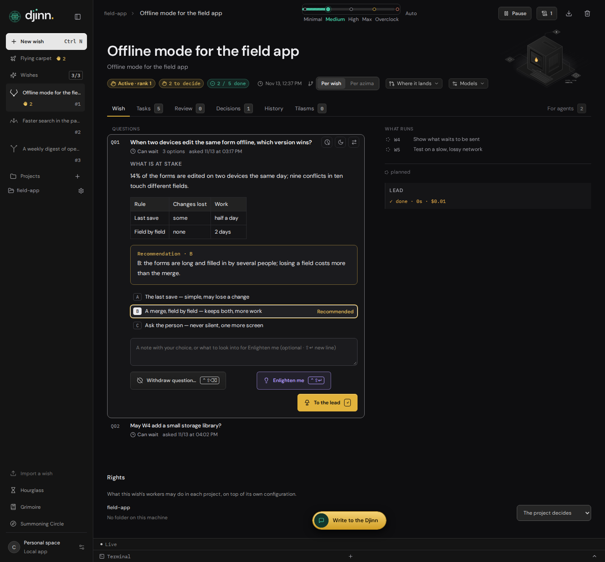
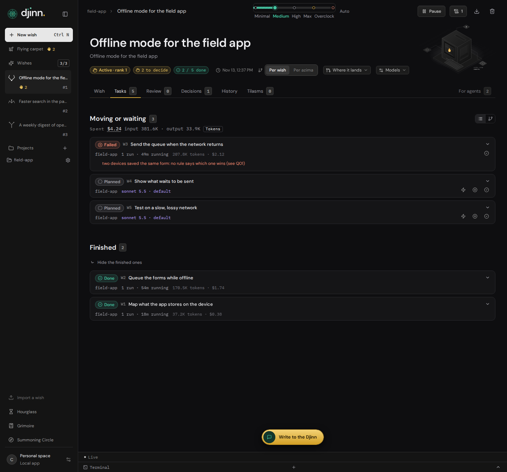

<p align="center">
  <picture>
    <source media="(prefers-color-scheme: dark)" srcset="docs/site/assets/mark-dark.svg">
    
  </picture>
</p>

# Djinn

_A wisp of smoke to work your will._

> **Beta.** Djinn has left alpha: it runs real work every day, its own development first, and what it does is covered
> by tests. It is not v1 yet: some paths are verified by tests only (see [What beta means](#what-beta-means)), the
> command line and the API may still change, and the road to v1 is [below](#before-v1), with no date set.

Djinn turns what you wish into work done by coding agents, on your own machine, with your own accounts. It is one
command, `djinn`: a native window, a local server, and a command line the agents use. You make **wishes**; one
**Djinn**, the lead, plans each of them into tasks; **workers** of several agents (Claude Code, Codex, Antigravity)
carry them out, each in its own Git worktree; Djinn schedules, checks, merges and pushes their work. Everything that
needs you comes as a **question**, with a recommendation and the exact command when a move is yours to make.

<picture>
  <source media="(prefers-color-scheme: light)" srcset="docs/screenshots/readme/questions-light.png">
  
</picture>

## What no djinn can grant

Like the genie of the lamp, Djinn has limits, and they are the project's first rule:

- **It can't kill anybody.** Nothing destructive or irreversible (a deletion, a force push, a deployment) happens
  without your explicit go.
- **It can't make anybody fall in love.** It never bends anyone else's will: no message, approval or merge sent in
  your name that you have not seen.
- **It can't bring anyone back from the dead.** What failed stays failed: no made-up result, every claim comes with
  its evidence.
- **No wishing for more wishes.** It never grants itself more than it was given: no extra budget, no wider access,
  and no secret it stores or reads.
- **Three wishes at a time.** One Djinn holds three active wishes at most, and as many set aside as you like.

**Workers commit, and never push.** Each commits its work in its worktree; Djinn merges each one's work as it ends,
checked, and pushes on a cadence: one CI run per push instead of one per worker. It opens pull requests as drafts,
and never marks them ready nor merges them: that stays yours.

## Install

One line, no administrator rights. The script picks the build for your system, checks it against the release's
`SHA256SUMS`, and puts `djinn` in your own folders (`~/.local/bin` on macOS and Linux). On Linux without WebKitGTK it
installs a build that opens Djinn in your browser.

```sh
curl -fsSL https://github.com/Empowill/Djinn/releases/latest/download/install.sh | sh    # macOS, Linux
```

```powershell
irm https://github.com/Empowill/Djinn/releases/latest/download/install.ps1 | iex         # Windows
```

Then run `djinn up` (`djinn up --browser` prints a URL instead of opening a window). The latest release is
[v0.4.0](https://github.com/Empowill/Djinn/releases/tag/v0.4.0), and its [notes](docs/releases/v0.4.0.md) say what
each part still needs.

**Agents.** Djinn asks for no API key and stores none: it runs the agents you installed and signed in to, and your
account pays for them. **Connections & preferences** shows which ones it finds and installs or signs them in from the
window; the **Summoning Circle** picks the agent and model for the Djinn and for each kind of worker, and ranks your
sign-ins when you have several Claude accounts. By hand: `npm install -g @anthropic-ai/claude-code`,
`npm install -g @openai/codex`, and for Antigravity see [`docs/providers.md`](docs/providers.md#antigravity).

**macOS builds are not signed yet.** The `curl` install is not affected; a `Djinn.app` downloaded with a browser
must be allowed once in *System Settings › Privacy & Security*, or with `xattr -dr com.apple.quarantine Djinn.app`.

### From source

With Go 1.25+ (and CGO for the window), Node.js 22, and on Linux the GTK and WebKitGTK headers (the full list is in
[`CONTRIBUTING.md`](CONTRIBUTING.md#getting-set-up)):

```sh
git clone https://github.com/Empowill/Djinn.git && cd Djinn
npm ci
go tool task install    # installs djinn in Go's bin folder, with its menu entry on Linux
djinn up
```

## What works today

What is below is merged on main and covered by tests (the [release notes](docs/releases/) say what ships in each
tagged build). Every concept has its page in the [Grimoire](#documentation).

- **Wishes and azimas.** A wish is what you ask for, across one or more projects. The Djinn splits it into _azimas_
  (goal-sized parts of the plan) and tasks in a conflict-free parallel graph; each work task is one worker in its own
  worktree. Azimas are ranked by priority, can wait as drafts, move between wishes, and end **To validate**: their
  card lists the proofs only a person, a machine or a real model can give, and **Validate** closes them.
  [Guide](docs/user-guide.md#a-wish) · [Azimas](docs/user-guide.md#azimas)
- **One Djinn for every wish.** A single lead sees every active wish, so it spots duplicate or conflicting work. By
  default Djinn drives it without a terminal, in a fresh Claude Code or Codex session per batch of events, from
  `djinn brief`, a summary Djinn writes without a model, and from notes built into the binary (`djinn lead notes`).
  A chip names where it runs and moves it across agents, accounts or models; the **History** tab and
  `djinn lead journal` show its batches; **Write to the Djinn** (Cmd/Ctrl+I) sends it your words. Its tone follows the
  window's theme: a solar Djinn in light, a mocking demon in dark. [Guide](docs/user-guide.md#the-djinn) ·
  [The Djinn](docs/site/pages/the-djinn.md)
- **Questions and moves.** The Djinn says nothing for you in a terminal: every report, doubt, choice or "done" is a
  question in its wish, ordered by urgency (**Blocking**, **Your move**, **To decide**, **Can wait**), with options
  and a recommendation selected from the start. The answer button names what starts: **Build**, **Iterate**,
  **Investigate** launch the option's planned worker at once, **To the lead** hands the answer to the Djinn.
  **Enlighten me** sends an investigator, with web search, to dig first and revise the question; **Later** and
  **Sleep** set it aside until a task ends, a pull request merges or a date passes. A move only you can make puts every
  command to run in one code block at the top; a check or a CI result is never asked of you. The window is driven from
  the keyboard too. [Guide](docs/user-guide.md#questions) · [Question and move](docs/site/pages/question-and-move.md)
- **Tilasms.** A tilasm is a self-contained, sandboxed HTML page (`djinn://tilasm/<id>`) the Djinn or a worker writes
  to show an analysis, a comparison, a diagram or an interactive mockup, versioned in Djinn's data folder, never in
  your repository. It opens full size over a question or in the **Tilasms** tab; you comment a passage or an element
  inline, then **Iterate** or **Launch** sends the comments in one batch. A tilasm and the question linking it settle
  each other. [Guide](docs/user-guide.md#the-tilasms-tab)
- **Investigations, mockups and ifrits.** Besides work tasks, the Djinn can start an **investigation** (a short,
  bounded study) or a **mockup** (rounds of visual exploration), which never merge and end in a tilasm and a question.
  An **ifrit** is an interactive worker that stays lit while you are active, keeps its dev servers up with clickable
  ports (`djinn serve`), goes out when you leave, and merges through the project's checks when finished.
  [Guide](docs/user-guide.md#an-ifrit-a-worker-that-stays-lit-while-you-are-there)
- **Watchers, pull requests babysat, templates and the Inbox.** A **watcher** is an agentless command task, zero
  tokens and zero worker slots, that wakes the Djinn when its command's output changes. Project skills can declare
  **wish templates**, **babysit** every pull or merge request a task opens until it merges, and plug **Inbox** sources
  that surface outside requests. [Watchers & templates](docs/user-guide.md#watchers-and-wish-templates) ·
  [Babysitting](docs/user-guide.md#babysitting-pull-requests) · [Inbox](docs/user-guide.md#the-inbox)
- **Your work lands where you choose.** Per wish, one integration branch; per azima, one branch cut from main whose
  draft pull request Djinn opens at its first push. Djinn merges each task's work, runs the project's checks, starts a
  correction worker when they fail, and pushes on a standard cadence or on demand. A project describes its limits to
  Djinn in a `djinn.yaml`. [Guide](docs/user-guide.md#team-settings-and-integration) ·
  [Push strategy](docs/site/pages/push-strategy.md)
- **Review.** Each task shows its whole diff; a comment on a line reaches its worker or becomes a correction task. The
  **Review** tab lists the merged work to tick off, and the **Decisions** tab every decision taken, by whom, and what it
  led to. [Guide](docs/user-guide.md#the-review-tab)
- **Several Claude accounts.** Workers run on every Claude sign-in you add, the one whose week ends soonest first or in
  the order you set; a worker that hits its account's limit moves to another with its session.
  [Several Claude accounts](docs/site/pages/several-claude-accounts.md)
- **Your machine stays yours.** A load slider, from **Minimal** to **Overclock** or **Auto**, sets how much of the
  machine the workers take. Every command a Claude worker runs takes its turn through **gates**, heavy ones one at a
  time, and a **memory brake** freezes, then interrupts, the worker whose memory grew outside them before the machine
  runs out. [Gates](docs/user-guide.md#gates) · [Machine and load](docs/site/pages/machine-and-load.md)
- **The flying carpet and the Hourglass.** **The flying carpet** (Ctrl+1 / Cmd+1) shows every active wish at once, the
  inbox, and what waits for you first. **The Hourglass** (Ctrl+2 / Cmd+2) shows the **Machine** (CPU and memory over
  time, each worker, where command time goes, the disk and what to clean) and the **Statistics** of the work, which
  `djinn query` reads from a terminal too. [Flying carpet](docs/user-guide.md#the-flying-carpet) ·
  [Hourglass](docs/user-guide.md#the-hourglass) · [Queries](docs/user-guide.md#queries)
- **Stops lose nothing.** A watchdog wakes a worker gone silent and continues it on its own session; each task has a
  _seal_ (time, turns, spending cap, what it may edit and run). Quitting Djinn stops every worker, watcher and check it
  started, and the next start resumes them; after a crash, or with `djinn up --paused`, it resumes none until it knows
  why. [Guide](docs/user-guide.md#when-djinn-stops-and-starts-again)
- **Share a wish.** **Share** exports a wish to a `.djinn` file (its plan, questions, decisions, tilasms; never code
  nor secrets) that **Import a wish** opens on another machine; `djinn wish sync` keeps a static page of it up to date.
  [Guide](docs/user-guide.md#share-a-wish)
- **Logs, a debug dump and updates.** `logs/djinn.log` in the data folder records each call, command, error and panic,
  never a prompt or a secret; `djinn debug dump` says where each part waits when Djinn freezes. A banner offers a newer
  Djinn with its release notes; nothing restarts without you. [Guide](docs/user-guide.md#when-djinn-is-stuck)

### Systems

| System  | Builds                                         | What is verified                                                                                                                               |
| ------- | ---------------------------------------------- | ---------------------------------------------------------------------------------------------------------------------------------------------- |
| Linux   | amd64, arm64: GTK 3, GTK 4, browser            | Daily use, on amd64 with GTK 3. Every test runs in CI.                                                                                         |
| macOS   | one universal binary, and `Djinn.app`          | Used on a Mac during the port; the native end-to-end test passes there. Go tests run in CI. The release archives are not checked by hand yet. |
| Windows | amd64, arm64                                   | Go, interface and end-to-end tests run in CI, not yet as a required check. Not checked yet on a physical machine.                             |

## What beta means

Djinn builds itself every day, with a Claude Code lead on Linux; much else is covered by tests but not yet by use.
Not verified yet:

- **Codex** is tested against recorded streams, not yet run for real by this project as a lead or a worker; its
  accounts are listed and ordered, but their quota is not read. Antigravity has run real tasks; it reports no sign-in
  status.
- **macOS by hand** from a release: `Djinn.app` opened from the Finder, its notifications, the title bar, a crash.
  The builds are not signed nor notarized.
- **Windows and arm64 Linux on real hardware**, including the Windows window and SmartScreen. On Windows, workers
  cannot be paused and their memory is not measured yet.
- **GitLab**: merge requests opened and babysat, tested against a fake forge, not yet on a live GitLab project.
- **An update from inside the app** from one release to the next.

The data folder is kept across versions; the command line and the API may still change before v1.

## Roadmap to v1

Djinn is tracked here, with no other tool: one file per task in [`plan/`](plan/README.md), with what to do and the
questions still open.

### Before v1

The four themes that lead from beta to v1:

1. **Delegating tasks between machines** ([`T28`](plan/b4286211-work-spread-over-trusted-machines.md)).
2. **Peer-to-peer collaboration on artifacts (tilasms)** ([`T29`](plan/e6e6605e-collaborate-on-a-wish.md)).
3. **Simpler QA and human validation (reworking the review).**
4. **Tuning the Djinn's tone of voice.**

### Proposals

_Proposals, not decisions: each one needs a yes before any work._

1. **Hand one task to another machine first.** T28 plans a whole mesh of trusted machines; sending one ready task, with
   its session, to a machine you name would prove the trust and the transport early, and give you a second machine's
   slots now.
2. **Comments on a shared tilasm come back to the wish.** `djinn wish sync` writes a page one way only, and T29 leaves
   open how a comment returns; tilasm comments already reach the Djinn in batches, so they are the natural first path
   back, and a colleague's remark on a mockup reaches the wish without a copy and paste.
3. **Validate an azima, not each task.** The Review tab ticks merged work task by task, while the proofs live on the
   azima; one place per azima with its diff against main, its proofs and **Validate** would let you check a feature
   once, as you think of it.
4. **Try it before you tick it.** Validating a front change today means running it yourself; an ifrit lit on the
   azima's branch, its ports one click away, would put the running change in front of you at validation time.
5. **The Djinn's tone, chosen apart from the theme.** The tone follows the window's theme today; a setting of its own
   (plain, solar, demon) in the Summoning Circle, with a sample question, would let you keep the dark theme with a
   plain Djinn, on a shared screen or with a team.
6. **A plain tone for what leaves Djinn.** A shared wish or page carries the questions in the tone they were written
   in; writing what a teammate reads in the plain tone would keep the jokes between you and your Djinn.
7. **Lessons a team teaches its Djinn.** Lead notes change only with a Djinn release; notes a project keeps beside its
   `djinn.yaml` would let a team's lead learn its conventions without waiting for one.
8. **Codex on equal terms with Claude.** Codex accounts are ordered but their quota is not read, and no real Codex run
   is verified yet; reading its quota and running a real Codex lead and worker would make the agent choice a real one.
9. **Windows workers that pause and are measured.** Pausing a worker and its memory figures are missing on Windows;
   without them the load slider and the memory brake protect a Windows machine less.
10. **A first start with something to see.** A new user meets an empty window and spends tokens before seeing a
    question; the demonstration wish of the screenshots below, offered at the first start, would show a question, a
    plan and a review before the first real wish.
11. **A signed Mac and Windows install.** Unsigned builds stop a newcomer at Gatekeeper or SmartScreen; signing and
    notarizing them would make a downloaded app open like any other.
12. **A live GitLab check and an update tried release to release.** Both are tested against fakes only; one real run of
    each before v1 would turn them into verified paths.

### Done

**Phase 1 · Native app**

- [x] [T01 · The native window: the same interface as in the browser, where you talk to the lead, by voice too](plan/fe63ed30-native-window.md)
- [x] [T02 · The foundation: the protos, minimal data, a generated command line, in English, clean code](plan/c30479be-api-and-cli.md)
- [x] [T04 · Install and stay up to date: in a few minutes, updates from inside the app](plan/929d6a88-getting-started.md)
- [x] [T05 · Tested end to end: fast tests, and an agent that checks its work up to the real window](plan/b6a680bf-testing.md)
- [x] [T11 · Windows](plan/a586b68b-windows.md)

**Phase 2 · Orchestration and data**, after which Djinn runs on itself

- [x] [T07 · The orchestrator: Djinn decides, starts, resumes, integrates and pushes the work by itself](plan/8e8d3d76-orchestrator.md)
- [x] [T13 · Work across projects: a wish spanning several projects, a project's skills in another](plan/58ae4a59-cross-project-sessions.md)
- [x] [T14 · Fast, economical workers: the right context and model, sized to the machine](plan/8ce817da-cost.md)
- [x] [T18 · Antigravity as a worker provider](plan/a72eb1f8-antigravity-provider.md)
- [x] [T25 · Understand and decide at a glance: what waits for you first, clear questions, tilasms](plan/4a699d0f-review-at-a-glance.md)
- [x] [T26 · Every request finds its wish: routing, wish templates, an inbox](plan/e1210c5e-request-routing.md)
- [x] [T27 · Djinn stays fast, whatever the size of a wish: the window, djinn up and its start](plan/9ac1c08b-djinn-stays-fast.md)

**Phase 3 · Comfort**

- [x] [T19 · Releases: binaries for every target](plan/71f9c331-releases.md)
- [x] [T20 · Your wishes follow you: backups, a wish online, later your other machines](plan/9b71f059-backup.md)

<picture>
  <source media="(prefers-color-scheme: light)" srcset="docs/screenshots/readme/tasks-light.png">
  
</picture>

_Screenshots of a demonstration wish, with fictional data. `go tool task screenshots` takes them again._

## Documentation

[User guide](docs/user-guide.md) · [Providers](docs/providers.md) · [Agent protocol](docs/agent-protocol.md) ·
[Team settings](docs/team-settings.md) · [Wish templates](docs/wish-templates.md) · [Backups](docs/backup.md) ·
[Release notes](docs/releases/)

Every concept and command in one site: **Grimoire** in the window's side panel, served at `/docs/` while
`djinn up` runs, or `go tool task docs`, then `bin/docs/index.html`. Its pages are in
[`docs/site/pages/`](docs/site/pages/).

## Contributing

Everything you need to work on Djinn, person or agent, is in [`CONTRIBUTING.md`](CONTRIBUTING.md): the shape of the
project (the lamp and the smoke), its technical directions, how to set up, and its license rules. Coding agents read
[`AGENTS.md`](AGENTS.md) too. `go tool task test` runs every test, and no test calls a paid model.

## License

Djinn is free and open-source software under the [Apache License, Version 2.0](LICENSE). Third-party dependencies and
their licenses are listed in [`docs/THIRD_PARTY_NOTICES.md`](docs/THIRD_PARTY_NOTICES.md), shipped with every release.

## Credits

Thanks to Clément Fauvelle ([@clemzer0o](https://github.com/clemzer0o)) for the macOS and Codex port and for the
design of the window. The engine and some adapters are studied from [T3 Code](https://github.com/pingdotgg/t3code).
The avatars use [Thinking Orbs](https://libraries.dev/orbs). Djinn's diagrams and illustrations are original.
