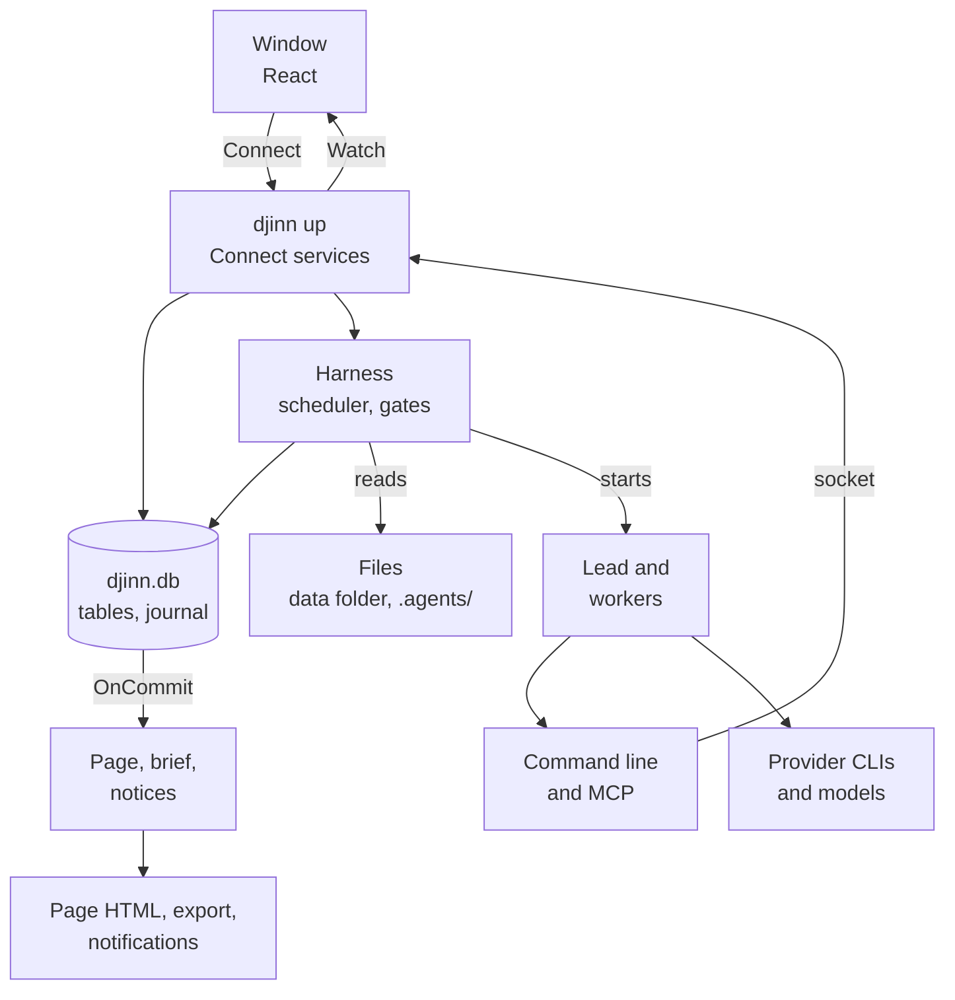
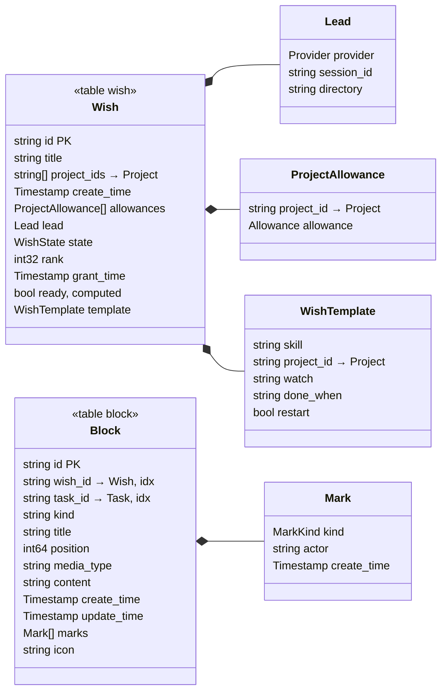
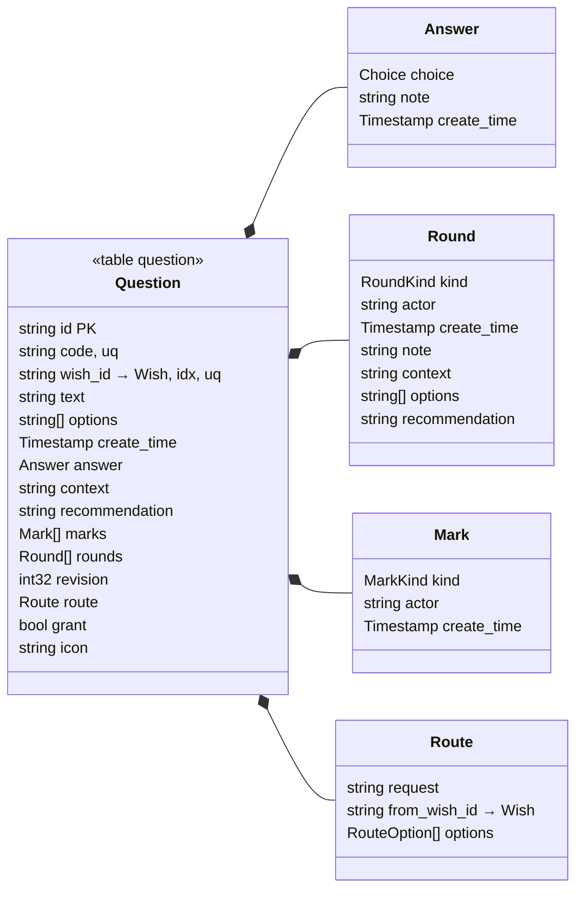
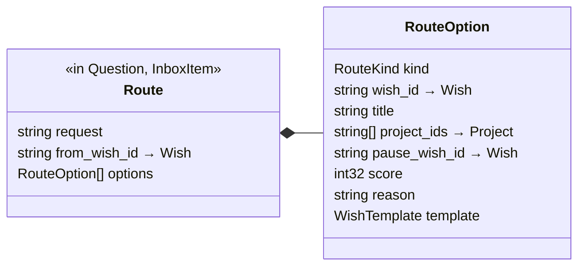
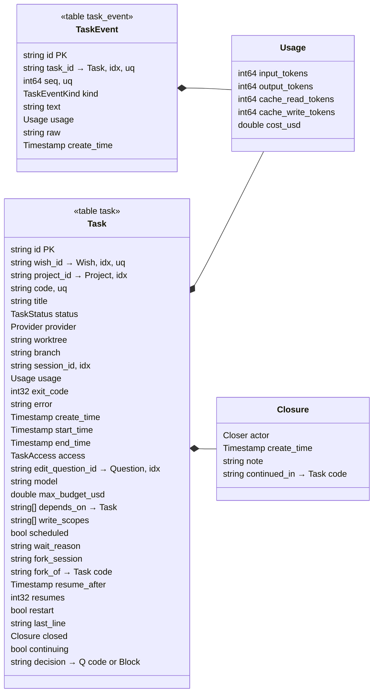
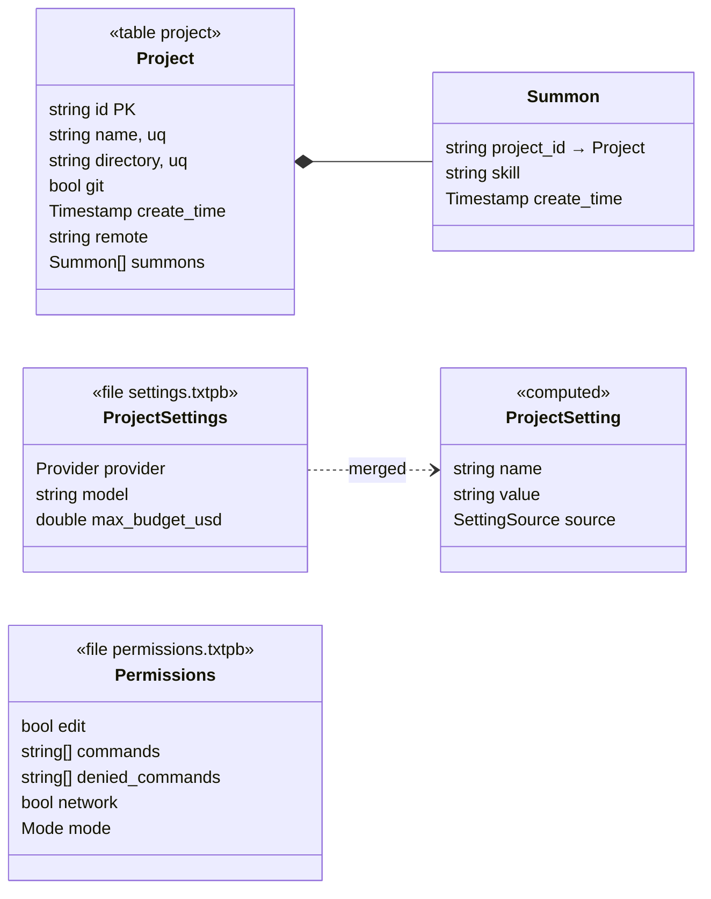
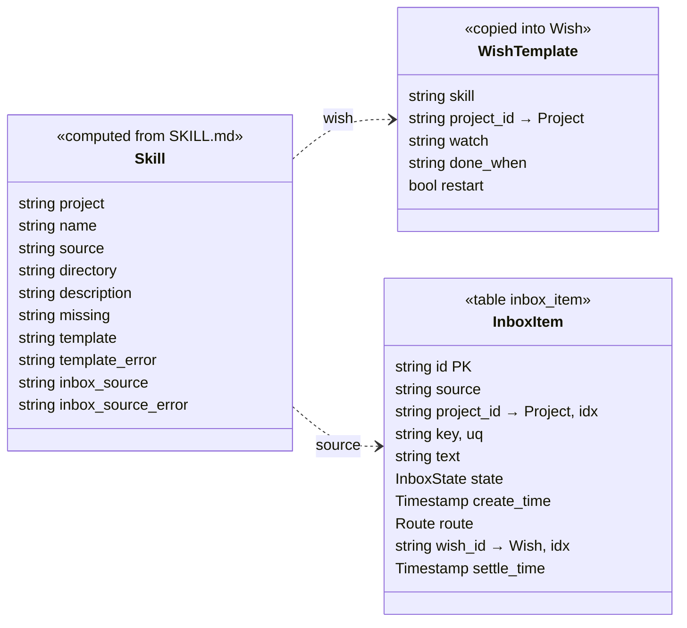
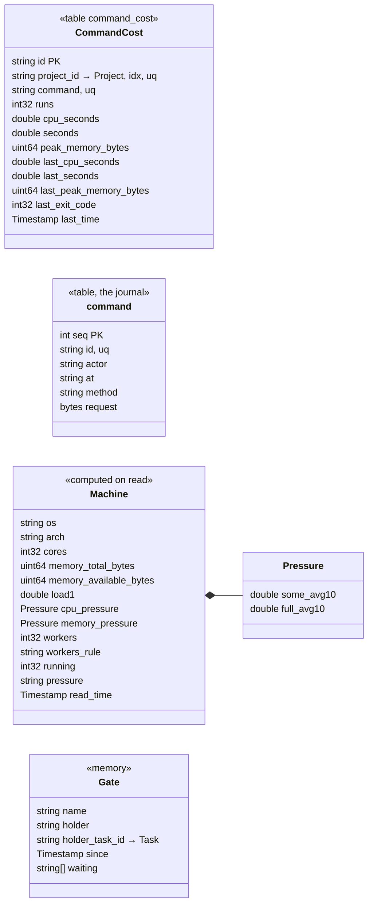
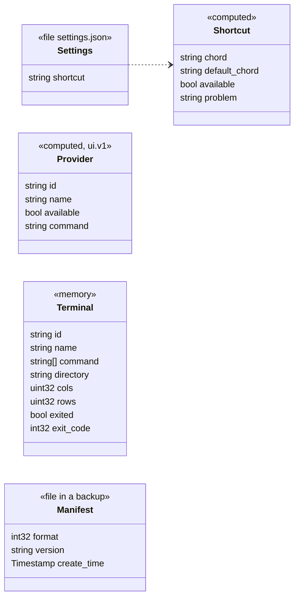
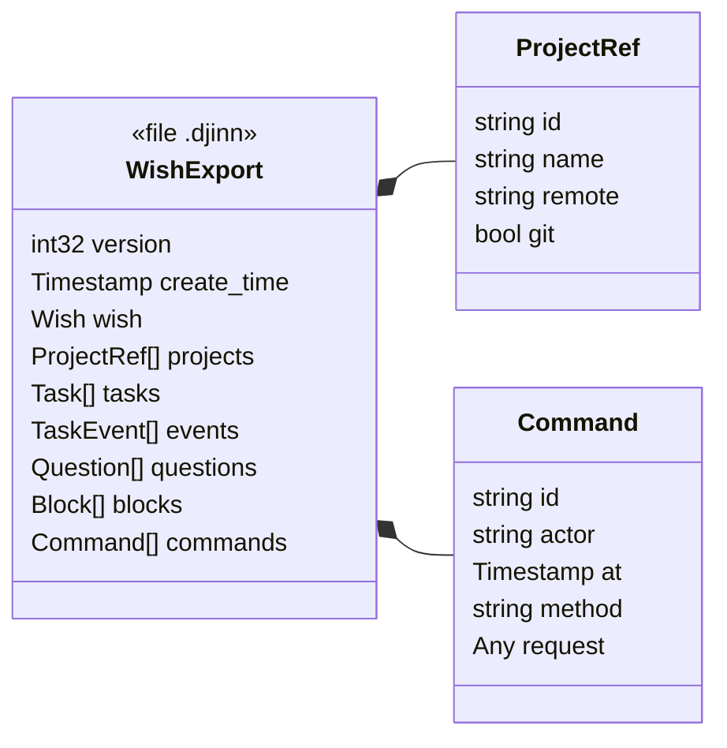

# The data model

What Djinn keeps, where, and who writes and reads it. A map for a review: what each model is for, and where it
could be simpler. The protos in `api/` are the source of truth; this page follows them, and
`TestDataModelDoc` (`internal/plan/datamodel_test.go`) fails when a message of the protos is missing here.

Requests and responses (`…Request`, `…Response`) and enums stay out of the diagrams: they carry data, they do not
keep it. An enum shows as a field's type.

## Where data lives

| Where | What | Written by |
| --- | --- | --- |
| `djinn.db`, SQLite, in the data folder | One table per stored message, plus the journal `command` | `internal/store`, in a transaction |
| Repository of a project | `.agents/settings.txtpb` (`ProjectSettings`), `.agents/permissions.txtpb` (`Permissions`), skills (`SKILL.md`) | The team, by hand |
| Data folder | `projects/<id>/settings.txtpb` (`ProjectSettings`), `settings.json` (`ui.v1.Settings`), `state.json` (the window's workspace, a JSON string), `restart.json` (leads to reopen), worktrees | Djinn, or the developer |
| Memory of `djinn up` | `Gate`, `Machine`, `Terminal`, the scheduler's queue | Djinn |
| Files you carry | A wish export (`WishExport`, `.djinn`), a backup (zip with `Manifest`), the wish's page (HTML) | Djinn, on request |

**The store.** `plan.Entities()` lists the stored messages: `Project`, `Wish`, `Task`, `TaskEvent`, `Question`,
`Block`, `InboxItem`, `CommandCost`. Each gets a table named after it: `id` as primary key, every singular string
field named `*_id` as an indexed column, each `(djinn.v1.unique)` group as a unique index (case ignored), and the
whole message as a binary `payload`. Any other field lives only in the payload: adding one needs no migration.
Nothing is ever dropped. Every write goes through `Store.Tx`, which writes the command that caused it into the
`command` journal in the same transaction.

## Flows

Who writes, who reads, through which service, down to the store and the workers.

- **One writer.** Every change goes through `djinn up`, a service or the harness, then `Store.Tx`. The command
  line, MCP and the window are clients of the same Connect services; `djinn mcp` serves the commands of the command
  line as tools. The window talks over `wails://` or loopback HTTP, the command line over a Unix socket or loopback
  HTTP ([transport](transport.md)).
- **The window copies, never computes.** `src/data/store.ts` lists what it shows, then follows
  `WishService.Watch`, which says only what changed (`Change`); the store reads it again. Task events come by
  `TaskService.Watch`, for the tasks it follows.
- **The harness** is the only writer of `TaskEvent`, and of a task's run fields (status, usage, times, session).
  The scheduler (`internal/dispatch`) picks the next tasks from the store, with the slots the machine monitor
  allows. At launch the harness reads the project's `.agents/` (permissions, settings, skills) and the developer's
  settings, and starts the provider's command line in the task's worktree. Workers call back through the command
  line: `djinn gate run` (held in memory by `internal/gate`, its cost kept as `CommandCost`), `djinn task send`.
- **Derived views.** On each commit the store calls its hooks: the pages of synced wishes are rendered again
  (`internal/render`), the window's watch streams are told, and the window's notices read new questions. The lead's
  brief (`internal/plan/brief.go`) is read from the store when the lead starts or asks.
- **What leaves the machine.** Prompts go to the providers' command lines. The wish's page is an HTML file `djinn
  wish sync` keeps current; the lead republishes it. An export or a backup is a file you ask for. Nothing else.

## Wishes and blocks

How to read the diagrams. `<<table x>>` is a stored message and its table; a class without a stereotype lives
inside its parent's payload. `PK` primary key, `idx` indexed column, `uq` part of a unique index. A diamond is a
message held inside another; `→ Wish` in a field is a reference by id. The diagrams run left to right so that they
stay readable in the window's column.

## Questions and decisions

A decision is a question with an `answer`, or a block of kind `decision`. There is no decision table.

## Tasks, events, closures and usage

## Projects, settings, permissions, skills, templates and inbox

A wish template is not stored on its own: a skill declares it in its `SKILL.md`, and a wish made from it keeps a
copy (`Wish.template`).

## Machine, gates, costs and the journal

The journal is a table of its own, not a message: `request` is the binary request of the method it names. An
export carries the wish's entries as `Command` messages, with the request as an `Any`.

## Window, terminals, backup and exchange

The window's workspace (open tabs, layout) is one JSON string in `state.json`, opaque to Go
(`UiService.LoadState`, `SaveState`). `restart.json` lists the lead terminals to reopen; it is a Go struct, not a
proto.

## The models explained

One line each: what it is for, who writes it, who reads it.

**Stored, in `djinn.db`**

| Message | For | Written by | Read by |
| --- | --- | --- | --- |
| `Project` | A folder Djinn works in, its remote, the skills it summons | `ProjectService.Add`, import, `SkillService` | Everything |
| `Wish` | What you ask for: title, projects, state and rank, rights, lead | `WishService` (make, route, import, allow, pause, activate, move, grant, set-lead), the inbox | Window, page, brief, scheduler, notices |
| `Task` | One item of the plan and its worker's run | `TaskService` (spawn, done, continue, pause), the harness, the scheduler (`wait_reason`) | Window, page, brief, scheduler |
| `TaskEvent` | What a worker said and did, in order | The harness only | `TaskService.Watch` (window, `djinn task watch`), page, export |
| `Question` | A question to the developer; answered, a decision | `QuestionService`, Djinn itself (edit, route, grant questions), `MarkService` | Window, page, brief, notices, shortcut |
| `Block` | Free content of a wish: the smoke | `BlockService`, a routed request, `MarkService` | Window, page, brief, routing (latest blocks) |
| `InboxItem` | A paragraph a skill's source printed, proposed as a request | The inbox, `InboxService` | Window's inbox |
| `CommandCost` | What a command cost in a project, summed | `CommandService.Record`, from `djinn gate run` | `djinn command list` |
| journal `command` | Every write, with its request | `Store.Tx` | Export and the window's journal: requests of the API only |

**Held inside a stored message:** `Lead`, `ProjectAllowance`, `WishTemplate` (in `Wish`); `Usage`, `Closure` (in
`Task`, `Usage` also in `TaskEvent`); `Answer`, `Round`, `Mark`, `Route`, `RouteOption` (in `Question`; `Mark`
also in `Block`, `Route` also in `InboxItem`); `Summon` (in `Project`).

**In files:** `ProjectSettings` (team and developer defaults of the workers), `Permissions` (what a worker may run),
`ui.v1.Settings` (the global shortcut), `Manifest` (a backup's header), `WishExport`, `ProjectRef`, `Command` (a
wish carried to another machine).

**Computed, never kept:** `Machine`, `Pressure` (read from the system), `Gate` (in memory), `Terminal` (in memory),
`Skill` (from `SKILL.md`), `ProjectSetting` (the merge of the two settings files), `ui.v1.Provider`, `Shortcut`,
`Wish.ready`.

**Parts of requests and responses:** `QuestionRef`, `MarkTarget`, `Marked`, `ProjectMatch`. `djinn.v1.Unique` is an
option of the protos, read by the store.

## Simplification candidates

Facts are proven by the code cited. What a change would cost is an estimate.

1. **Each worker event is written twice.** The harness writes a `TaskEvent` row and, in the same transaction, a
   `harness/event` journal entry whose request is the same event (`internal/harness/harness.go`, `writeAs`). No code
   reads a `harness/*` entry back: `plan/exchange.go` `request()` finds no service named `harness` and skips it.
   The journal grows as fast as the events. *Cost:* journal the event's `(task_id, seq)` instead, or nothing for an
   event; the rule "every write has its journal entry" holds with a small entry. Old rows stay.
2. **`TaskEvent.raw` keeps each provider line as it came**, up to 64 KiB, next to the `text` made from it. Read only
   by `djinn task watch --raw` (`internal/harness/service.go`); an export drops it. *Cost:* lose the raw view for
   debugging, or keep it only for errors and the last events of a task.
3. **`Mark.actor` and `Round.actor` are always `local`** (`const actor` in `internal/plan/plan.go`) and no code reads
   them. *Cost:* none to stop writing; keep the field number reserved. Keep them if agents get an identity soon.
4. **`Question.revision` counts the `REVISE` rounds**: `internal/plan/rounds.go` appends the round and increments
   it together. *Cost:* count the rounds in three readers (brief, page, window).
5. **`InboxItem.settle_time` is written, never read** (`internal/plan/inbox.go`). *Cost:* none; or show it.
6. **`UiService.Watch` is declared, not served, never called**: `internal/ui` embeds the unimplemented handler and
   no client calls it. Its two messages go with it. *Cost:* none.
7. **`DemoService` is served by `djinn up`** and called by no client of the window or the command line. *Cost:* none,
   unless a measure of the transport needs it.
8. **`Task.session_id` is an indexed column** only because its name ends in `_id`; no query filters on it. *Cost:*
   an index per task write, small; renaming the rule's exception is more code than it saves.
9. **`Wish.ready` is computed on every read but sits in the stored message.** It is reset before each read and on
   export. *Cost:* moving it to the responses changes the window's `Wish` type in many places; low value.
10. **`Task` holds both the plan and the run** (33 fields): what to do (title, dependencies, scopes, decision) and
    what the worker did (worktree, session, usage, error, resumes). *Cost:* a split into two tables touches the
    harness, the scheduler, the page, the window and the export format. Not worth it before a second kind of run.

Seen and kept: `Task.access` repeats the answer of the edit question, but every launch needs it without a join;
`Closure.continued_in` and the fork's `fork_of` are the two ends of one link, and the scheduler reads the first
(`internal/dispatch/dispatch.go`); `Wish.rank` is 0 exactly when the wish is not active, and the state still tells
paused from granted.
