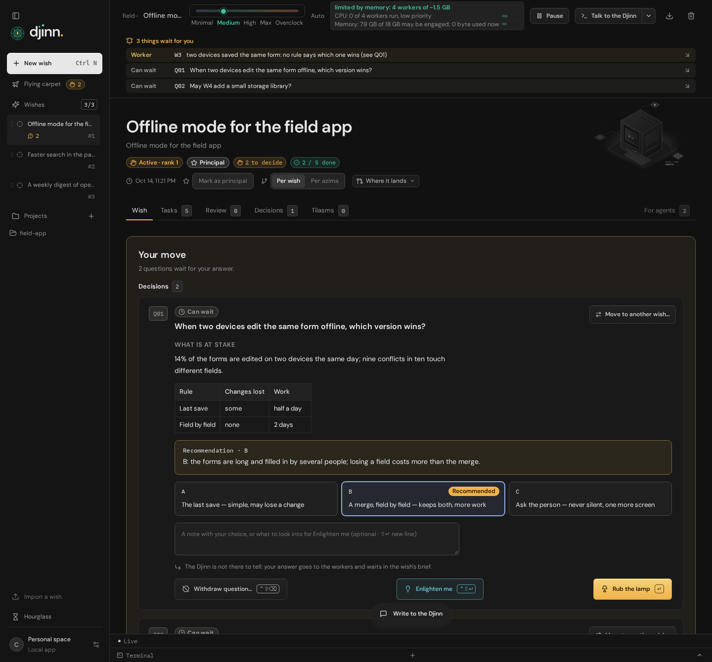
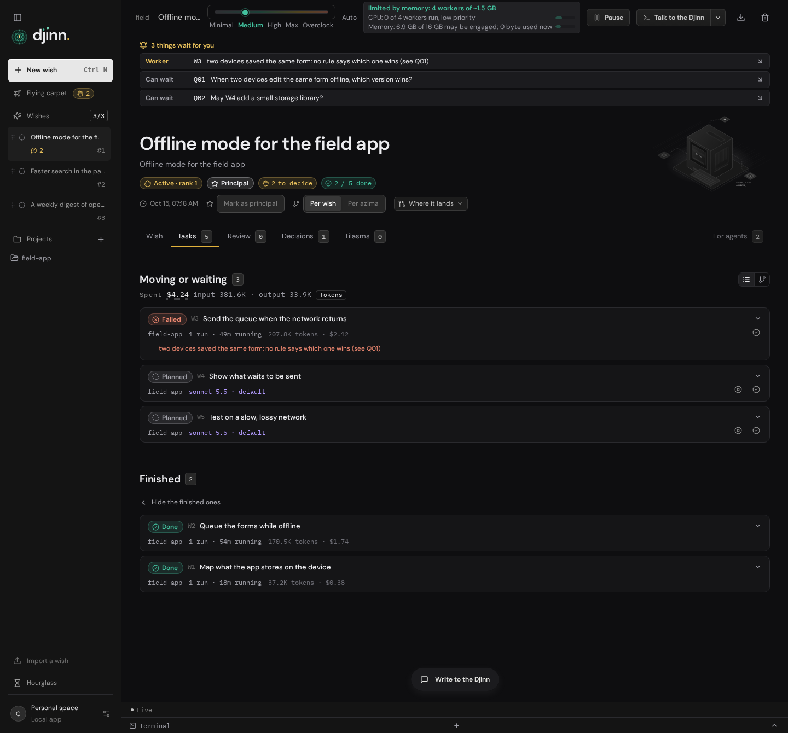

# Djinn user guide

How to get going with Djinn, then use its flying carpet day to day. Djinn is one command, `djinn`: a window, a local
server, and a command line your agents use to drive a wish. You say what you wish; its lead, the Djinn (Claude
Code, Codex or Antigravity), splits it into tasks; workers do them; you answer the questions and grant the wish.

> **Alpha.** Djinn is under development: see the warning at the top of the [README](../README.md).

<picture>
  <source media="(prefers-color-scheme: light)" srcset="screenshots/readme/questions-light.png">
  
</picture>

## Install

The one-line install is in the [README](../README.md#install), with how to build Djinn from this repository
([`CONTRIBUTING.md`](../CONTRIBUTING.md#getting-set-up) has the details).

The Djinn and the workers run the agents you already have, as you installed and signed in to them:

- Codex: `npm install -g @openai/codex`
- Claude Code: `npm install -g @anthropic-ai/claude-code`
- Antigravity, optional: [`providers.md`](providers.md#antigravity).

**Connections & preferences** (bottom of the side panel) shows, one line per agent, whether Djinn finds it, its
version, and whether it is signed in (`claude auth status`, `codex login status`; Antigravity has no such command, so
its sign-in shows as unknown), with a button to install it or sign it in. The button runs the agent's own command in a
terminal of the panel, where you answer if it asks; once it ends, Djinn checks again. The same panel opens from the
arrow beside **Talk to the Djinn** (**Set up the agents**), and by itself when the window opens with no agent ready. The agents are looked
for where the Djinn and the workers find them: Djinn's PATH, your login shell's, and the installers' folders. Djinn asks for no API key,
and stores none: the account each agent signs in with pays for it.

## Start Djinn: `djinn up`

```sh
djinn up              # the window
djinn up --browser    # no window: prints the URL to open in your browser
```

- **One Djinn per data folder.** A second `djinn up` brings the running window to the front.
- **The data folder.** It is `djinn` in your system's configuration folder (`~/.config/djinn` on Linux,
  `~/Library/Application Support/djinn` on macOS, `%AppData%\djinn` on Windows). `DJINN_HOME` sets another one.
- **Closing the window does not stop Djinn.** The Djinn and the workers go on. To quit: "Quit Djinn" in the tray menu,
  Ctrl+Q (Cmd+Q on macOS), or stop `djinn up`.
- **How many workers at once.** The machine decides: one per 2 cores and per 2 GiB of memory.
  `djinn up --workers 4` (1 to 16) sets it. The status bar shows `Workers 2/4`, and whether the page is `Live`.
- **Worker CPU and memory limits.** On Linux, workers run in systemd user scopes. CPU can be capped with
  `--worker-cpu` (e.g. `150` for 1.5 cores). Memory limits can be set with an expert static ceiling (`--worker-memory`)
  or an adaptive guardrail based on observed provider peaks (`--worker-memory-guard 2.5`): [worker memory](worker-memory.md).
- **Operating load slider.** Controls how much of the machine Djinn uses: five manual notches (**Minimal**,
  **Medium**, **High**, **Max**, **Overclock**), or **Auto** (`light` is accepted as an alias for `medium`). Click a
  notch's label or its round stop on the track (or Tab to a stop, then Enter or Space).
  Hovering the slider, or reaching it with the keyboard, shows a dual gauge forecast under it: CPU (how many workers run of the most the notch lets run, exactly what the
  scheduler allows there, every agent counted and watchers not, with the workers started by hand and those finishing
  their run above the limit; standard versus low CPU priority) and Memory
  (peak memory Djinn may engage against current usage and total machine RAM). The **Overclock** notch pushes up to
  150 % of standard memory capacity with an amber visual pulse. In Auto mode, Djinn dynamically follows developer
  activity: keyboard and mouse inactivity from the desktop session, combined with the CPU and memory load of programs
  outside Djinn. When you type or move the mouse, or other programs put the machine under heavy load, the notch drops
  directly to Minimal to yield the machine to you; when idle for a few minutes with little load, it slowly climbs back
  towards your chosen ceiling. Where no session idle source is available (SSH, headless, unsupported desktop), it falls
  back to host load alone. In Auto, lowering the notch lowers CPU priority and stops starting new workers, never
  pausing running ones (Decision Q124 (C)). From the command line: `djinn load get`, `djinn load set minimal` (or any notch),
  and `djinn load watch`.
  Each notch engages a worker's memory at a percentile of its readings (a running worker at its own, a new one at the
  median of the latest 10 finished workers' value), plus a margin; builds and tests spike a worker's memory, and the
  gates already run them one at a time. The memory Djinn may commit counts its running workers' own memory once, back
  into what it could use with no worker running. `djinn load get` and `djinn machine show` say it (`worker_engaged_at:
  engaged at p50 (overclock)`):
  - **Minimal**: p95, 512 MiB margin (`light`, an alias for `medium`, takes Medium's).
  - **Medium**: p80, 512 MiB margin.
  - **High**: p70, 384 MiB margin.
  - **Max**: p60, 256 MiB margin.
  - **Overclock**: p50, 256 MiB margin.

### The terminal

The window has a terminal at the bottom. It opens in the folder of your first project (the first of the side panel),
never in your home folder: an agent started there would ask you to trust all of it. With no project yet, the terminal
asks you to create one. `djinn up --terminal-dir <folder>` picks another folder, and
`djinn up --terminal "…" --terminal-dir <folder>` runs that command instead of your shell.

It holds tabs. The window's own terminal is always there; while the Djinn runs, its tab, **The Djinn**, is there too. The + of the tab bar, or Ctrl+Shift+T anywhere in the window, opens a new shell
(**Shell 1**, **Shell 2**…); the terminal icon next to a project in the side panel opens one at its root. Each tab you
opened closes with its ×, and comes back after a reload. The terminal folds away; **Restart** starts one again once
its program ended, and on the Djinn's tab it starts the Djinn again as **Talk to the Djinn** does. Ctrl+Shift+C and Ctrl+Shift+V copy and paste.

## A project

A project is a folder Djinn's workers work in. Git or not: a folder outside Git works too.

- In the window: **Create a project** (the + next to Projects), then the folder (**Choose a folder…** in the window;
  type the path in the browser) and, optionally, a name.
- From a terminal: `djinn project add <folder>`.

Click a project to see its configuration, as Djinn reads it on this machine. What waits for you comes first, in red
("To fix"): each thing in a sentence, the error as read, and what settles it (a file to correct, a source to plug in or
say no to, a skill to unsummon). Then its reference branch (the ref and commit Djinn merges, and where its name comes
from), its checks, the inbox sources of this machine, its skills with the role each has for Djinn (a wish template, an
inbox source, a babysit, or know-how for the workers alone), its push cadence, and every other setting with where it
comes from: Djinn's default, the team's file or yours. Skills summoned from another project show "from app".
`djinn skill summon app/babysit-mr --into infra` lets infra's workers use a skill of app without a copy.

## A wish

**New wish** (top of the side panel) opens **Make a wish**: what you wish, in a sentence, and the projects it works
on. Or from a terminal, or from the Djinn: `djinn wish make "…"`. Under the wish's title, a click gives it the few
lines it opens with: what it is for, its scope, where it goes (`djinn wish describe <wish-id> --text "…"`). Clicking
the title allows you to rename it (`djinn wish rename <wish-id> --title "…"`). Beside the title, a star button marks
it as the **Principal** wish (**Mark as principal**): the Djinn coordinates from it and receives there the answers of the other
wishes (`djinn wish principal <wish-id> --principal`). When unset, the active wish with the lowest rank is principal.

**Three wishes are active at most.** That guards your attention; the machine decides how many workers run. You may
have as many wishes as you like: with three active already, a new one is made paused (**Make it paused**). The side
panel lists the active wishes by rank, the first has priority: drag one by its grip, on its left, or Alt+Arrow, to change
its rank. The paused wishes follow, then the granted ones, each list in its own order, which every window shows and a
restart keeps: drag one within its list, or Alt+Arrow, to change its place. A wish paused or granted comes first in its
list. While you drag, a thin line shows where the wish will land.

At the top of a wish:

- **Pause** sets it aside: its workers stop, each on its own session, and its place frees up.
- **Resume** makes it active again: its workers start again where they were, without counting as a resume. With three
  active already, it takes the last place, and the last active wish is paused. Dropping a paused or granted wish among
  the active ones makes it active at that rank, the last active one paused when three are; **Make it the first active
  wish**, next to a paused one in the side panel, puts it first.
- **Reopen** brings back a granted wish.
- The bin, **Delete this wish**, deletes it for good after you confirm: its tasks and their events, its questions and
  its blocks. Its running workers stop first. A worktree with no work of its own goes;
  one with commits or changes not committed stays, and every branch stays.

From a terminal: `djinn wish pause <wish-id>`, `djinn wish activate <wish-id>`, `djinn wish move <wish-id> --to 1`,
`djinn wish reorder <wish-id> --to 1` (a paused or granted wish, first in its list),
`djinn wish rename <wish-id> --title "…"`, `djinn wish principal <wish-id> --principal`, `djinn wish delete <wish-id>`.
`djinn wish add-project <wish-id> --project-id <project>` adds a project, by its name or identifier, to a wish made
without it: its tasks may spawn there, and its finished work goes to the branch the project's checkout is on.

## The Djinn

Djinn has a single lead for all active wishes, the Djinn: an agent session that talks with you, splits wishes into tasks, asks
the questions and keeps the plans true. It drives Djinn with the `djinn` command.

The app is Djinn, its lead is the Djinn; the workers are its hands. **Talk to the Djinn**, at the top of a wish, opens
the Djinn in the terminal of the window and focuses it on that wish; at the top of the flying carpet, it opens it on no wish:

- the Djinn has a session: Djinn resumes it (`claude --resume …` or `codex resume …`) in the folder it was recorded
  in, or shows it if it runs, and types a short line focusing on the wish;
- it has none: the Djinn starts anew on Claude Code in your first project, never in your home folder. With no project at all,
  nothing starts: create one first.

The arrow beside **Talk to the Djinn**, **Choose the agent**, starts the Djinn on another agent found on this machine: Claude Code,
Codex or Antigravity. An agent that is not installed shows greyed, saying so; the recorded one is checked, and picking
it resumes the Djinn, focused on this wish. Starting the Djinn on another provider replaces its session.

Every new session of the Djinn, on any agent, starts by running `djinn brief`: every active wish at once (each wish's title, description,
open questions, what runs and waits, its azimas), then Djinn's rules and the projects' (`AGENTS.md`, `CLAUDE.md`,
`CONTRIBUTING.md`). `djinn wish brief <wish-id>` gives one wish's detail. No model writes it.

The Djinn talks to you only in the window: everything it has to tell you, a report or "done as you asked" included,
is a question in the wish concerned, often a yes/no acknowledgement with "OK, nothing to do" as an option, and it
withdraws one as soon as a task or Djinn does what it asked. When it does not fully understand an answer, it asks
again before starting any work. It writes nothing for you in its terminal; a line you type there is answered in the
window.

From a terminal, `djinn lead resume` does what **Talk to the Djinn** does, and starts Djinn if it does not run;
`djinn lead resume --provider codex` picks the agent. `djinn lead set <session-id> --directory <folder>`
records a session you started yourself. `djinn lead tell "…"` writes to the running Djinn as if you typed it in its
terminal, line breaks kept (`--wish-id <wish-id>` says which wish it is about); it waits while you type there or a
choice is on screen. In a wish, the pill **Write to the Djinn** at the bottom does the same about that wish, and
on the flying carpet about no wish (Cmd/Ctrl+I opens it; Enter sends, Shift+Enter breaks the line, Escape, a click or the focus elsewhere folds it and keeps the draft).

When the agent behind the Djinn asks for your approval in its terminal (a command to run, a folder to trust), the bar of what
waits for you shows it first, in the flying carpet and in every wish, with its options as buttons, and a notification
says so. A button answers in the terminal as its keys would, only while the terminal still shows that very choice: a
different command needs a new click.

When the Djinn could not start, from **Talk to the Djinn** or as the app starts, or its program ended (it failed at once, or you quit
it), a small dot on **Talk to the Djinn** says so, in every wish and on the flying carpet: its tooltip gives the error or the exit code. The Djinn's tab keeps its last output, and
reopening it starts nothing. Only **Talk to the Djinn**, or `djinn lead resume`, starts it again; the dot goes once it runs.

At every start, the Djinn comes back, in its terminal. The first start after an update from a version that had
one lead per wish keeps the lead of the first active wish as the Djinn.

## The flying carpet

**Flying carpet**, at the top of the side panel, or Ctrl+1 (Cmd+1 on macOS), shows every active wish together:

- a bar at the top while something waits for you, the most blocking first; a click takes you there;
- the [inbox](#the-inbox), when a source found something, one you plugged in fails, or a project has something to fix;
- each wish at a glance: its questions, what runs, or `READY`;
- what waits for you, in every wish: open questions, workers that wait for your answer before they edit, wishes
  Djinn proposes to grant, and the **Proofs you can give** (see [azimas](#azimas)). A worker that failed, refused
  calls included, never waits for you, nor notifies you: it is the Djinn's, which asks you a question only for a right
  it lacks, with the command that grants it;
- the questions you asked the Djinn to investigate.

Each line names its wish; an answer, a stop or a grant goes back to it. Like a wish, the flying carpet has a **Tasks**
tab and a **Decisions** tab, with the tasks and decisions of every active wish. An empty section is hidden.
Under them, one line says the machine's load, with a link to the [Hourglass](#the-hourglass).

## The Hourglass

**Hourglass**, near the bottom of the side panel, after Import a wish, or Ctrl+2 (Cmd+2 on macOS), is where the live metrics are, as
time goes by. First the machine: its CPU and memory over the time you pick (10 minutes to 7 days), with Djinn's share,
the load limit and the gates held; each running worker, its facts and its own graphs (its eye opens the task in its
wish); then where the time of the commands goes, by project and gate. The page reads them only while it shows: leave it,
and its reads stop. A running task's card links to its worker's row (**Live in the Hourglass**).

Ctrl+1 and Ctrl+2 are the keys' places, not their characters: on a French AZERTY keyboard, Ctrl with the key of &
and Ctrl with the key of the e acute next to it; the numpad's 1 and 2 work too. They work in a text field, never in
the terminal, which keeps its own Ctrl and digit keys. Each entry's tooltip names its shortcut as your keyboard writes
it, once the window knows your layout: at once in a Chromium browser, elsewhere once you typed on the digit row.

## A wish's view

The **Wish** tab: what waits for you (**Your move**), the questions being investigated, the journal (**Show the
commands**), and the **Rights** of its workers in each project. Beside it, the **Tasks**, **Review**, **Decisions**
and **Tilasms** tabs, and last, discreet, **For agents**.

**Rights** says what the wish's workers may do in a project, for every task to come: **The project decides** (its
own configuration), **Edit the files**, or **Edit, in auto mode**. A worker in a folder outside Git with no rule
reads until you say it may edit: it shows as **Waits for your answer**.

### The Tasks tab

What moves or waits for someone first (running, failed, then waiting and paused, the planned ones last), then the
finished work part of no azima, folded under **Finished**, then the azimas with the work part of them, the done ones
folded, with what they spent. Finished work part of an azima shows under it.

Each task is displayed as a two-line row:
- The first line displays the status badge first (**Running**, **Waits for your answer**, **Planned**, **Done**,
  **Failed**, etc.), its code `W1`, `W2`…, and its title, with the full prompt on hover.
- The second line gives its project, agent provider and model, duration (or waiting time: for a slot, dependency,
  or gate), its model turns against its seal's limit (`37/500`, its run's; it turns orange past 80%, and its
  hover gives the total over its runs), token counts and cost estimate, and for a running worker its live CPU and
  memory usage (not measured on Windows yet).

Clicking a task opens its card body: when it started and ended, the files it writes, its budget, its folded prompt,
diffs, its worker's last word, where its work stands, its events, and folded terminal logs with **See logs** (or
**Hide logs**).

- **See the diff** opens a drawer from the right of the window with the task's committed work: its files in a column,
  each file's diff beside them. **See uncommitted files** opens it on its other tab, what the task's worktree holds not
  committed (changes to tracked files, staged or not, and new files), read only; it says when the worktree is clean or
  gone, and the button is off for a task with no worktree. The refresh button reads the diff again; the close button,
  Escape or a click beside the drawer closes it. `djinn task diff <task> --uncommitted` gives the same from a terminal.

- **Send** an instruction to a running worker, in the box under its events. "Received" shows once the worker said
  something after it.
- **Pause the worker** holds a running worker where it is and frees its slot; **Resume the worker** lets it go on.
  None on Windows yet.
- **Stop the worker** ends it.
- **Mark done** closes a task no worker runs (planned, cut short, failed, stopped, imported) once its work is done,
  with why, in a few words.
- A task that comes from a decision links to it in the Decisions tab.

The calls a worker's permissions refused, with nobody to approve them, never show in the window (Decision Q273): they
go to the Djinn, in the event that tells it the task ended, with the commands and the right that would allow them. The
Djinn decides: it continues the task otherwise, starts it again where a right the wish or project already grants
covers them, or closes it as seen. Rights stay explicit: when the Djinn concludes a new one is needed (auto mode on a
project, a permission line), it asks you in a question to act on that names exactly that right, the command that
grants it, and why.

The status is one colour, one icon and one word: Running, Waits for your answer, Planned, Done, Failed,
Interrupted, Stopped, Paused, Waiting for the limit, Resuming, Resumed as another task, Watching.

### Usage and cost estimates

Every task, wish, and the flying carpet show token breakdowns (input, output, cache read, thinking) and an estimated cost computed from an embedded price table (`internal/usage/prices.yaml`), marked "estimated, prices of <table date>".

- **Estimated vs. reported**: Claude reports monetary cost directly in its stream, which Djinn preserves and shows labelled "reported" alongside the estimate. For providers without stream costs (Codex, Antigravity), Djinn converts tokens to cost using the price table.
- **Comparable across providers**: A switch in usage views toggles between currency ($) and tokens, so comparisons across models and providers remain consistent without flattening when a model has no price.
- **Missing prices**: Models without public verified pricing in the table show tokens and "no price in the table". Wish and provider totals note how many tasks have no price.
- **Local overrides**: The embedded table loader leaves a clear seam for local overrides from `~/.config/djinn/prices.yaml` (or `$DJINN_HOME/prices.yaml`) without requiring configuration UI today.

`djinn task pause <task-id>` holds a worker where it is and frees its slot; `djinn task resume <task-id>` lets it go
on (not on Windows yet). A worker that holds or waits for a gate is not paused.

<picture>
  <source media="(prefers-color-scheme: light)" srcset="screenshots/readme/tasks-light.png">
  
</picture>

_The two screenshots show a demonstration wish, with fictional data._

### Azimas

The Djinn's plan is a graph of azimas, coded `T01`, `T02`…: parts of the plan that no worker runs, which work is part
of. The Tasks tab displays the azimas in a single column from top to bottom, each row taking the full width to show
its code, goal, state, progress (parts done, running, and waiting), time, and dependencies, with the work part of it
folded underneath. The tasks inside an azima may flow in columns on a wide screen, but the azimas themselves stay in
a single list. The top of the wish counts the azimas done before the tasks.

The order of azimas is stable between renders and between days, so an azima stays at the same place: first the azimas
that move (a worker running, in progress or watching), then those waiting for the developer (awaiting proof / to
validate), then the ready ones not started, then blocked ones, then drafts, and last the done ones folded at the end. Within each group, azimas follow
the plan's code order, never an order by time or by counts that change every minute.

An azima is **Draft**, **Open**, **In progress**, **Watching**, **To validate** or **Done**. It is **Watching** when a
watcher is its only live work, such as the babysit of its pull request: no work task part of it runs, waits or is left
to merge. Like in progress, it is not done: what depends on it still waits, and it moves with the ones in progress.
A draft azima holds tasks planned for later: **Open this azima** (`djinn task open <azima>`) turns it open, ready for
parts to be spawned, and notifies the Djinn. **Move** (`djinn task move <azima> --wish <wish>`) moves an azima (a draft, or an azima no worker runs with parts that have
not started) to another wish.

Each wish has a **Push strategy**: **Per wish** (one integration branch per wish and project) or **Per azima** (one
branch per azima, named `djinn/<code>-<slug of its title>`: `djinn/T07-the-orchestrator`). In the wish header, the push
strategy can be switched, or set from a terminal with `djinn wish push-strategy <wish-id> --strategy wish|azima`. For an
azima with its own branch, status badges show **PR proposed**, **PR open** or **PR merged**, with buttons to open or
merge the PR. An individual **Push** button (`djinn project push <project> --wish <wish>`) pushes the branch on demand
when you choose.

**Where work lands.** Per wish, a wish's work lands in its integration branch, in each project the branch your checkout
was on when the wish was made: the chip beside the push strategy names it (with the project, when the wish has several),
and a click on it changes it to another local branch or to a new one made from it (`djinn wish set-integration <wish>
--branch feat/x`, `--create-branch` for a new one), refused while a merge into it runs. Per azima, each azima's work
lands in main through its own branch and pull request, which its card shows once opened, and work of no azima in the wish's
integration branch; `djinn wish brief` and `djinn brief` say it in a line for each wish.

An azima's branch works like a wish's integration branch. Djinn cuts it from main when the azima is made (an azima made
before its wish was switched gets its branch when its first part starts), and records it on the azima: its card, opened,
shows the branch, the commit of main it was cut from, and that it lands in main. The azima's work merges into it, and Djinn keeps it up with
main by the same rules as a wish's branch ([keeping up with main](team-settings.md#keeping-up-with-main)). It lands in
main: its pull request, opened as a draft when you say yes to Djinn's proposal, targets main and follows each push of
the branch; Djinn never re-targets it.

A project whose branches follow a convention (a ticket's key) names an azima's branch with `djinn task update <azima>
--branch <name>`: a branch that exists is adopted as it is; one only the remote holds (an open pull request's) is made
from the remote's; one that does not exist is cut from main under that name. A wish
whose work already lives on its integration branch switches to per azima once the azima carrying it adopts that branch;
before, Djinn refuses the switch, which would strand that work, and says how
([naming an azima's branch](team-settings.md#pushing)).

Under the per-azima strategy no azima waits for another: each branch holds main and its own work, nothing else. Djinn
refuses an azima after another, directly or through their work (`djinn task spawn --after`, `djinn task depend`,
`djinn task update`, `djinn task group`, an `after:` line of a plan file at `djinn plan sync`), and refuses switching a
wish to per azima while its azimas depend on each other: the window says which in a line, and the switch stays on per
wish. Tasks inside one azima wait for each other as usual. A branch made before, stacked on the branch of the azima it
depended on, keeps working as it is: Djinn never cuts it again nor rewrites it.

Once every task part of an azima is finished, it is **To validate**: nothing is left for Djinn. Its card says what
validating it takes, box by box of its plan file (a person, a machine, a release or a real model gives each proof), and
its **Validate** button marks it done. An azima whose plan file says done stays **In progress** while work part of it
still runs or waits. The flying carpet lists the proofs a person can give among the **Proofs you can give**.

### The Review tab

The wish's merged work, a line per task, the merges Djinn started under the task they serve; the tab counts what is
left to review. A click on a line opens its diff, with the comments on its lines; its box marks it reviewed, kept with
who checked it and when, and the Djinn reads it in its brief and with `djinn mark list`. What is reviewed folds at the
end. **See the diff** stays on each task's card in the Tasks tab.

### The Decisions tab

Every decision, the latest first, read only: an answered question, or a block of kind `decision`. Each row says who
took it (you, the Djinn, or a worker) and the tasks it led to.

### The Tilasms tab

A tilasm is the material that explains a wish: a folder with an `index.html` (a page, a diagram, a demonstration),
coded `L01`, `L02`…, versioned, and kept in Djinn's data folder, never in a project. The Djinn makes them with
`djinn tilasm put`; you may drop a folder or a `.zip` on the tab.

**Open it here** shows one in a frame of its own: its scripts run, the network and Djinn stay out of its reach. The
tab searches the tilasms' titles and text, lists each one's **Versions** (**Restore this version** makes an older one
the latest again), and **Export as a .zip** writes one to your Downloads folder. Each tilasm says what it explains:
the azimas and tasks it cites. Its agents draw its diagrams by hand, in SVG, and keep in its folder all it needs, its
fonts and scripts: it reaches no network.

A tilasm's link, `djinn://tilasm/<id>`, opens Djinn on it from a browser, a chat, a terminal or a Markdown file, and
starts Djinn if it does not run; so does `djinn://wish/<id>` for a wish. Inside the window, such a link in a block, a
question or the brief opens in place. A tilasm's link in a question opens it full size over the page you read, without
leaving it: close it, or press Escape, and you are back on the link, ready to answer.

## Questions

The Djinn asks you rather than guessing. A question card, coded `Q01`, `Q02`…, gives the Djinn's
recommendation first, then the options A to D, then what is at stake. Its colour says how much it holds up: red
when a task waits for the answer, orange under the words the Djinn gave ("before the merge"), grey when it **Can wait**.
The cards and the brief list them in that order. The bar of what waits for you, at the top of the flying carpet and of
a wish, lists only what keeps a wish from moving forward: the red and orange questions (a move of yours needed before
something among them), the tasks waiting on you, the wishes ready to grant; a question that can wait is in the
questions column alone.

When work leaves a move only the developer can make (push a tag, open or merge a PR, start a release, check on a Mac or
Windows, install when needed), Djinn or the agent asks it as a question, the exact command in a code block at the top
of its context. A check, a measure, a log or a CI result is never asked of you: an agent runs it and reports.

- **Rub the lamp** answers with the option selected and your note: the recommended one is selected first, so one
  click takes it; pick another and the lamp sends that one. With no option recommended, pick one first. The Djinn
  turns your answer into tasks itself, in one pass, holding the plan's graph. A question without options takes a written answer, sent the same way.
- **Enlighten me**, on its left, starts an investigator worker to dig first, in one click (`enlighten_workers: false`
  lets the Djinn investigate itself): the note you typed says what to dig into (empty, it digs in general). The question
  folds to one line, **Being investigated** with what you asked, out of the way of the questions that wait for you; a
  click opens it, and you may still decide now. Revised, it opens again and waits for your answer. Its context
  is its current version only: **Versions (3)**, a small button in the card's corner, opens the earlier versions
  below the question, to read, the last one first, each with what you asked to investigate about it; a second click
  closes them. `djinn question revise` prints the current version too, its rounds with `--history`.
- **Keyboard shortcuts.** Focus on the card, or in its note field, drives it from the keys:
  - Enter in the note field rubs the lamp: answers with the option selected. An input method composing does not
    answer, nor does Enter answer before an option is selected.
  - Enter or Space on an option, like a click, only picks it: elsewhere on the card, Enter alone answers nothing.
  - Shift+Enter makes a new line in the note field.
  - Ctrl+Enter (Cmd+Enter on macOS) answers from anywhere on the card, never a new line.
  - Ctrl+Shift+Enter (Cmd+Shift+Enter on macOS) triggers Enlighten me from anywhere on the card, the note included,
    sending what the note asks.
  - Arrows (Up/Down/Left/Right) or 1–4 pick an option when focus is on the card and not in the note.
  The shortcuts stay on the card: they never intercept keys from the terminal or other inputs.

Your answer goes to the Djinn and the workers. An answered question is a decision. When the Djinn planned the
task an option launches, picking that option without a note launches it at once; a note goes to the Djinn first,
which adjusts the task to it before launching. From a terminal,
`djinn question answer <question> <choice>` answers a question; the Djinn's terminal is marked with `$DJINN_LEAD`,
so an answer typed by the Djinn is attributed to it without echoing back to its own terminal, whereas an answer
typed in a plain shell is attributed to the developer and reaches the Djinn. When a question is answered in
any wish, the answer is queued for the Djinn, which waits on `djinn lead watch`: nothing is typed in its
terminal while its watch runs, so nothing lands in your prompt box; without a watch, Djinn types one short line,
"Djinn: N events waiting, run djinn lead watch". If the Djinn does not run, the question is marked **Waiting for the Djinn** until
the Djinn acknowledges it; the next `djinn up` queues it for the Djinn. While Djinn drives the lead
(`"leadDriven": true` in `settings.json`), there is no terminal and no watch: the answer goes to the next batch's
session, whole, and `djinn lead journal` shows what each batch did. The lead runs on the agent, model and account
you choose, from the arrow beside **Talk to the Djinn** or with `djinn lead move`, until you move it; when it hits its
subscription's limit, the attention bar offers each other agent or account in one click, and Djinn moves it nowhere by
itself. An account is a folder of the agent's own where it keeps its login (`djinn lead add-account`, then its
sign-in once): see [the lead's seat and the accounts](providers.md#the-leads-seat-and-the-accounts).

An open question can be moved to another wish (`djinn question move <question> --wish <wish>`), with `--follow` to
bring tasks following this decision along with it. A question no longer relevant can be withdrawn without an answer
(`djinn question withdraw <question> --note "…"`), marked **Withdrawn**. A question you will take later goes to the
bottom of its wish's list with the clock in its top right corner, next to Move (`djinn question later <question>`):
Djinn keeps when you put it off, so it stays below the questions asked before, for the Djinn too, and a new question
still comes below it. The same button, pressed, gives it its place back (`--clear`).

A question that matters only once something happens sleeps until then: the moon beside Later asks what it waits for,
all of it to hold, the wish's tasks over (an azima closed), its pull or merge requests merged (as their babysit
watcher says), a time, or conditions typed (`djinn question sleep <question> --until W12,merged:W45,2026-10-20`; a
delay like `3d` works too; `djinn question ask` and `revise` take `--sleep-until`). Asleep, it leaves the questions
column and the bar: a grey **N questions asleep** below the column lists them on demand, each with what it waits for
and **Wake**, which wakes it now (`--wake`). Djinn checks the conditions at each pass of its scheduler; once they all
hold, the question wakes: the Djinn is told to check that its facts still hold (costs, tasks, requests) and revises it
if they changed, and it comes first in its wish's list, its grey line saying when it woke. A notification tells you.

**From anywhere.** In the window, a question asked in an active wish also shows as a system notification: a click
shows the wish, a button answers it (one per option, or **Yes**). The browser shows none; on macOS, notifications need
the app bundle. The **Global shortcut**, in Connections & preferences, brings Djinn forward on the wish with the
newest question (Ctrl+Alt+Space by default, Ctrl+Cmd+J on macOS; empty turns it off).

**A request that belongs elsewhere.** When something unrelated comes up, the Djinn hands it on and the window asks you
"Where does this request go?": file it in an existing wish, keep it where it is, or open a new one: the window opens it,
and the Djinn is told of it. Djinn ranks the wishes by their titles, projects and latest blocks, without a model.

## Everything for you is a question

Whatever the Djinn needs from you comes as a question, even without options when it really does not know what to
think: its analysis is in the card's context. A question you answered is resolved: the Djinn does not bring it back,
and asks a new one only on a real doubt.

### The For agents tab

What the Djinn and the workers write down for one another is a block: a hand-off, a reference, a report. Blocks are
not for you: they wait in the last tab of the wish, **For agents**, with their count, each folded under its title. A
click opens one: Markdown, shown as written, where a `mermaid` code block is drawn as a diagram, which **Expand**
enlarges. A block of kind `decision` shows in the **Decisions** tab instead, the log blocks in the journal.

A report (a block of kind `report`) is one of these notes: nothing counts it nor asks you to read it. When one
concerns you, it comes as a question that names it, by its title or its id: the card then shows **Report: …** with the
report's title, which opens it in place.

## Grant a wish

When every task is finished, none done with refused calls the Djinn has not decided about yet, and no question is
open, Djinn proposes to grant the wish:
**My wish is granted**. Only
you grant a wish; you may grant it earlier. From a terminal: `djinn wish grant <wish-id>`.

## Share a wish

**Share**, at the top of the wish, exports it to a `.djinn` file in Downloads: its plan, questions, decisions, blocks,
tilasms and journal. Never code (it travels through Git), never a secret, never a local path.

**Import a wish** (side panel), or `djinn wish import <file>`, opens it on another machine. Each project is found by
its remote, then by its name; one not found waits for `djinn project add <folder>`. Check its projects before you
resume it.

The wish's page, one HTML file standing alone that runs no script, comes from a terminal: `djinn wish render
<wish-id>` writes it once, `djinn wish sync <wish-id>` keeps it up to date while `djinn up` runs (delete the file to
stop).

## An ifrit: a worker that stays lit while you are there

When you want to iterate live, on changes you judge by eye or on a stack you try by hand, ask the Djinn for an
*ifrit*. It is a worker of a project, with its worktree and branch like any task, that does not end after its answer:
between two of your requests its process waits on its input, taking no slot and spending no token. One is lit per
wish; for work a task does alone with its checks, the Djinn spawns a task.

- **Lighting it.** The Djinn runs `djinn task spawn <wish> --kind ifrit --title "…" --prompt "…"`, on Claude Code or
  Antigravity (not Codex yet), in a project. It starts at once, beyond the slots, pausing no one; it takes a slot only
  while it works on a turn.
- **Talking to it.** You talk to the Djinn, which relays each request with `djinn task send W12 "…"`; you may also
  write in the box under its events. After each request the ifrit makes the change, says in three lines at most what
  changed and how to see it, then ends its turn. The Djinn does not repeat its answer, and asks you questions about it
  only for a decision (`--about W12`): they show in the ifrit's band.
- **Its processes.** It runs what lasts, a dev server or a stack, through Djinn, never in the background of its shell:
  `djinn serve run front "npm run dev" --port 5173=front` (`--gate stack`, `--stop "…"` for containers), `djinn serve
  list`, `djinn serve logs front`, `djinn serve stop front`. Djinn finds the ports they listen on and shows them as
  links. A serve's command must be allowed: listed in the permissions of the wish or the project, or allowed by you
  with `djinn project allow <project> --serve '<command>'` ([team settings](team-settings.md)).
- **Its gates.** A gate it holds stays held while it is lit, with no hour limit: a task that waits for it says "given
  back when you leave", and the Djinn offers you to finish or stop the ifrit.
- **In the window.** It shows in vermilion with a flame: its band comes first in what waits for you, with its state,
  its links, its questions, and **Keep lit** once Djinn warned that it goes out; its wish counts "1 ifrit lit"; the status bar counts the gates ifrits
  hold.

**When you leave.** Djinn keeps it lit while you are there: a key, a click or a scroll in the window in front, a key in
a terminal of Djinn, an answer, a mark, a message, a `djinn` command you type. The Djinn, the workers and the watchers
do not count, nor does the window left untouched. After 30 minutes without you, Djinn warns you with a notification,
"W12 goes out in 5 min", and its **Keep lit** button; 5 minutes later, once its turn under way ends, Djinn puts it
out: its input closes, its serves stop, its gates and slot go back. Its task is stopped, out, its worktree (uncommitted
changes included), branch and session kept, and the Djinn is told. `djinn up --ifrit-idle 1h` changes the delay for
this machine, and `--idle-minutes 60` at the spawn for one ifrit, from 5 minutes to 4 hours. A Djinn restart brings a
lit ifrit back out: no turn is paid for nothing.

**Lighting it again.** A message, from the Djinn (`djinn task send`) or yours under **Relight** on its card, resumes its
session in its worktree, starts its serves first, and tells it how long it was out. The Djinn never relights one
without your word.

**Finishing it.** Once its work is good, **Finish**, or the Djinn's `djinn task done W12 --note "…"`: its input closes
once its turn ends, its serves stop, its gates go back, and its work integrates like any task's, through the commit
checks. `djinn task stop W12` stops it and keeps its work without integrating it.

## Watchers and wish templates

A *watcher* is a task that runs a command, with no agent and no model: a pipeline, a merge request, a queue. Each
new paragraph it prints wakes the Djinn. Its card shows the first line of its last paragraph; **Pause the worker**
holds it, **Resume the worker** lets it go on. Its command runs when the project lists it in
`.agents/permissions.txtpb`, when a skill of the project declares it (a template's or a babysit's watcher, as Djinn
builds it), or when you allow it for yourself in the project's panel ("Watcher commands you allow") or with `djinn
project allow <project> --watch '<command>'`: [what a watcher may run](wish-templates.md#what-a-watcher-may-run).

A *wish template* turns a request that comes back (babysit a pull request, a QA run) into a wish that already knows
how to work: a skill declares it in its `SKILL.md`. When a routed request matches it, the new wish starts its watcher
and the Djinn follows the skill. When the watcher prints its "done" line, Djinn asks whether to grant the wish; it never
grants one itself. How to write one: [wish templates](wish-templates.md).

## Babysitting pull requests

When a task opens a pull or merge request (`gh pr create`, `glab mr create`), Djinn watches it at once, in the same
wish: once the task ends, a watcher task starts on it, part of the task's azima, and the Djinn hears `W5 opened MR
!123: W7 babysits it`. Each change the watcher prints (a failed pipeline, a comment, a conflict) wakes the Djinn, which
follows the project's babysit skill; the watcher ends when the request is merged. A request already babysat is not
watched twice, even by a watcher the Djinn spawned by hand on the project's babysit command: it hears
`W2 already babysits it`. The project names its watcher in one of its skills (`metadata.djinn.babysit`); without one, nothing
starts. `babysit: false` in the project's settings turns it off. The Djinn can start one by hand: `djinn task spawn
<wish> --title "Babysit W5's MR" --babysit --after W5`. How to declare it: [babysitting what a task
opens](wish-templates.md#babysitting-what-a-task-opens).

## The inbox

The **Inbox**, at the top of the flying carpet, holds what waits for you outside any wish; empty, it is hidden. A skill
may declare a *source*: a command that prints what comes from outside, like the merge requests assigned to you. Each
item becomes a card. Every card says three things, in this order: its kind (**Request**, **Djinn's configuration**)
and the fact; what Djinn will do once you hand it over (a wish that follows it with its skill's watcher, a block filed
in a wish, a new wish); and, under each choice, what that choice changes. A request's choices are where Djinn proposes
to send it, the recommended one first and marked, then **Dismiss**, which sets it aside for good. The side panel counts
the cards, and the window shows each new item as a system notification. Nothing is made until you click; **Rub the
lamp** takes the recommended choice. Djinn only reads a source: it never comments, reacts or replies. `djinn inbox
list` lists the items.

The sources live in their project's panel, under "Inbox sources", on this machine: what each reads, how its last run
went, and **Plug in** or **Unplug**, with what it does written under the button. A source runs only once plugged in, on
this machine; one this machine has not decided on is one of the project's things to fix, until you plug it in or
unplug it to say no. One you plugged in that fails gets a card of the kind **Djinn's configuration**: the error, since
when, how many runs failed in a row. Djinn runs it again on its own, and the first run that goes well takes the card
away; its other choice unplugs it.
A skill whose `metadata` Djinn cannot read is not listed as a source: it is one of the project's things to fix, at the
top of its panel and in `djinn project show`. Until it is fixed, Djinn ignores what it declares. Another line that
breaks the YAML, like `argument-hint: [a] [b]`, which Claude Code reads anyway, is only an information there, with the
line at fault: Djinn reads `metadata` apart from it. Details: [the
inbox](wish-templates.md#the-inbox-what-comes-from-outside).

A project with things to fix has its gear, beside its name in the side panel, red with a small flame (on its folder when
the side panel is folded), its tooltip counting them, and one line in the inbox under the cards: **Project** and its
name, how many things, the first of them in a sentence, and **Open its configuration**. The gear and the line open the
same panel, as a click on the name does; the detail stays there. Once nothing is left to fix, the gear turns grey and
the line goes.

## Team settings and integration

A repository may share defaults for its workers in `.agents/settings.txtpb`: which agent runs them, which model, how
much one may spend. Your own file, in Djinn's data folder, wins over the team's; a task's own flags win over both.
`djinn project show <project>` says where each setting comes from. Details: [team settings](team-settings.md).

When a project's settings name its checks, Djinn brings finished work into the wish's branch by itself: the tasks
ended and waiting go as one batch, their branches merged one on top of the other in a worktree of its own (made ready
by the `setup` command), the checks named for `commit` run once through their gates, and the branch moves when they
pass. Each task says where its work stands: waiting to be committed, committed, conflict, red, corrected by another
task. A branch that conflicts leaves the batch and merges alone after it; a conflict in code or a red check start a
correction worker, one for a whole red batch, and when that one fails, Djinn merges the batch one branch at a time to
find the culprit. One correction repairs a branch at a time: meanwhile nothing else merges into it, the work ended
waits in line, and merges once the correction is in. Once it is in and the branch green again, each running worker
of the wish that lacks the new work is asked, between two of its steps, to merge the branch itself, settle any conflict
with its own changes in mind and run the tests it touched; Djinn never merges in a worker's worktree. Past two
attempts, Djinn hands it to the Djinn, which decides what follows.

Each project defines its push cadence: **Standard** (pushes at an azima's end or after an hour and three tasks committed)
or **On demand** (pushes only when you click **Push** or run `djinn project push <project> [--wish <wish>]`). You can
switch cadence in the project view or with `djinn project set-push <project> standard|on_demand`. A push due waits for the work in line to be
merged and checked, 15 minutes at most. Before it pushes the branch,
it runs the checks named for `push`: red, the push is held, and Djinn starts a correction worker; if that fails or attempts
are spent, it tells the Djinn. `djinn project show` and the project's configuration in the window list the checks and
how each last ran.
When the settings also name an install command, the window proposes the build it pushed, one per integration branch:
on one line, its commit, the branch and wish it comes from, and against the running Djinn the tasks it adds, or "older
than the running Djinn on 3 commits" when the running Djinn holds commits it lacks; **Details** unfolds the tasks merged
since, each with its title and folded summary, and the commits' titles, folded. The build of the branch the running
Djinn was built from comes first; the other branches' builds are folded under one line that names them, each with its
own **Install and restart** and ×. Nothing of another branch installs before your click; × hides that build until a
newer one comes. A build of the running Djinn's own line (its branch, or one that carries it on), pushed past the
push checks, installs by itself, at low priority, once no gate runs and the machine is not under pressure: the banner
then says "Djinn local-abc1234 is ready" with what it adds, and **Restart** stays your click (the project setting
`install_builds: false` turns it off). While an install runs, the banner says what it waits for, then which step of
the install command runs; an install that fails, or works past its deadline (20 minutes), says why with the last lines
its command wrote, and **Try again**. With `install_questions: when_needed`,
Djinn raises no routine install question: the banner and post-push install are enough, and it asks only when necessary
(e.g. a build carries a fix for a task you are waiting on, a change that takes effect after restart and matters now, or
the running build is broken), saying why in the question; with `install_questions: never` (set in Djinn itself), no
install questions are asked. Details: [integration](team-settings.md#integration).

Djinn also keeps the wish's branch up with the project's main branch: it fetches main at most hourly, and once main
holds a release the branch lacks, it merges main in the same way, tested, never rebasing; a conflict starts a
correction worker. The wish's head shows the last merge, "origin/main merged into feat/x: 4 commits, v0.2.0". The
settings `main_branch`, `merge_main` (at each release, at each commit, or never) and `merge_main_minutes` change it.
Details: [keeping up with main](team-settings.md#keeping-up-with-main).

## Gates

Workers share one machine. Heavy commands (tests, builds, code generation) run through a gate of the running Djinn:

```sh
djinn gate run test -- go tool task test
```

A gate has one holder at a time, and is granted only while the machine is not under pressure; a command measured
before waits until the machine has the memory it peaked at. The status bar shows how many gates are held. `djinn
command list` shows what each command cost (CPU time, peak memory, duration).

Who gets a gate first: Djinn's own requests to merge a task's work into its branch (its wish's or its azima's), to
settle such a merge, or to run a push's checks, the first come first; then the others (a worker's `djinn gate run`, a
lead, your terminal), the first wish by rank first, then the first come. A merge or a push waiting for a gate keeps it
from the others, even when the memory would hold a lighter command; a gate already held is never taken back for it.
Each waiter says why it waits: `a merge or a push, served before the workers: held by W12 (…)` for Djinn's, `held by
W12 (…), for 40s, then 1 merge or push goes first` or `a merge or a push goes first: …` for the others.

A gate held outside a running worker (a merge's, a push's, your terminal's) takes one of the machine's slots; a
worker's own gate is in its slot. On a machine of more than one slot, one stays free for the merges and pushes: a new
worker waits (`5 workers run, 1 slot is kept for merges and pushes, the most this machine holds`), and a merge's gate
takes that slot. On a machine of one slot, none is kept: only the order above applies.

## When Djinn stops and starts again

Nothing is lost. Stopping Djinn interrupts the workers; the next `djinn up` resumes each one by itself, in the same
task, worktree and session, in the order of the wishes' ranks and within the machine's slots. It does not resume a
task imported from another machine, a task of a granted wish, a task whose worktree is gone, or a task already
continued in a fork. Such a task is history: it shows among the finished parts of its azima, never in what waits for
you; **Mark done** closes it, and `djinn task spawn --fork` starts a new task from its context. Only the resumes after
a usage limit count: after three of them, a task fails; a restart, a pause or a lost process spends none.

A worker stopped by its provider's usage limit shows "Waiting for the limit", then resumes once the limit resets.

The Lamplighter, Djinn's watchdog, wakes before it fails. A worker that prints nothing for 15 minutes, with no
process busy and no gate held or awaited, a worker whose stream goes idle, or whose process is lost, is ended and
continued on its session; only after three wakes in a row does its task fail, saying so, the Djinn told once. A
watcher (`--provider watch`) is supervised apart, for as long as its wish needs it: never ended for its silence,
which is its normal state, nor for a budget; a command of it that dies starts again in the same task, and only five
deaths in a row fail it, the Djinn told why. A budget is no wake: a task is stopped, "budget exceeded", past 2 hours
of work in total across its runs, or a worker past 500 model turns in one run, and stays stopped; `djinn task
continue` gives a stopped worker 500 turns again, not more time. These budgets are part of the task's
[seal](providers.md#a-tasks-seal). A Claude worker's count grows as it works; Antigravity
reports its own at the end of each answer, Codex none.

At every start, the Djinn comes back on its session, in its folder, however Djinn stopped. The other terminals come
back after an update, on the same sessions; not after a crash or a quit. When a newer release is ready, a banner
offers **Update**, with its **Release notes** when it has some; a newer Djinn already installed where it runs from
offers **Restart**: nothing restarts without that click. A Djinn
built from a checkout is named as a build is (its commit, branch and wish, what it adds and lacks); × hides it until
another version is installed. After the
restart, it lists the terminals that did not start again.

A Djinn you built from your checkout of Djinn (`go tool task install`) watches the releases too. With your checkout
on main, a newer release that holds your build installs by itself (the project setting `install_releases`, on by
default), and the banner then offers to restart on it; on a branch with work of its own, a release is never installed
over it: Djinn merges main into the wishes' branches instead, and proposes their build once the release is in
([releases of Djinn](team-settings.md#releases-of-djinn-for-those-who-build-it)).

`djinn backup` copies the data folder, even while Djinn runs: [backups](backup.md).

## When Djinn is stuck

Djinn logs what it does in `logs/` of its data folder (`~/.config/djinn/logs` on Linux,
`~/Library/Application Support/djinn/logs` on macOS, `%AppData%\djinn\logs` on Windows):

- `djinn.log`: one line per event, with its level: each call to the server (its method, how long it took, its error;
  over a second, a warning; an internal error, an error with its whole message), each command Djinn runs (git, gh,
  glab, the projects' checks: the program and its arguments, its folder, how long it took, its exit code, and whether
  it was killed at its deadline; one that succeeds within a second only at debug), each error of Djinn's loops (the
  scheduler, the integration, the pushes, the watchers: which one, which task or wish), each panic with its stack, each worker
  started and ended, the Lamplighter's acts, waits for the database or a lock over a second, a restart asked, and
  each step of a stop. It never holds a prompt, a message you wrote, or a secret. It rolls over at 10 MB and keeps
  4 older files (`djinn.log.1`, the most recent, to `djinn.log.4`): 50 MB at most, on every system. `DJINN_LOG=debug`
  adds the scheduler's and the integration's passes and the window's streams; `warn` keeps only what went wrong.
- `console.log`: what a Djinn started in the background prints (the window's toolkit, a crash), rolled over at a start
  past 10 MB.
- `crash.txt`: what Djinn died of, written by Go itself when a panic or a fatal error ends it; empty while Djinn
  runs. The next start renames it `crash-<time>.txt`, logs it in `djinn.log`, and keeps the last 5.
- `goroutines-<time>.txt`: where each part of Djinn waits, written on demand; the last 5 are kept.

A panic in a call to the server, or in the window, is logged with its stack and Djinn goes on (the call fails with an
internal error). Elsewhere, Djinn logs it with its stack and that it stops, then exits; the crash file says the rest.

When Djinn freezes, or does not quit, do not kill it first: run `djinn debug dump`. Djinn writes where each of its
parts waits to a new `goroutines-<time>.txt` and the command prints its path. It asks Djinn's server; a server that
does not answer finds a request file in `logs/` within a second. On Linux and macOS, `kill -USR2 <pid>` does the same.

A stop that takes more than 10 seconds dumps its goroutines by itself and logs the steps it still waits for (the
workers, the terminals, the database, the window and the server); after 30 seconds Djinn logs them again and exits
with code 3 instead of hanging. A restart that hangs starts the newer Djinn before it exits.

Killing Djinn leaves nothing running behind it: its workers, watchers and checks, and the commands a worker runs
under a gate, die with it. On Linux the kernel kills each worker at once; a small shell of Djinn's, the sentinel,
asks what they started to stop, and kills it 5 seconds later (on macOS, the workers too); on Windows a job object
kills them all. Djinn records each of them in `run/` of its data folder while it runs. Should one survive all the
same, the next start stops it before it resumes any task (its start time tells it from a later process with the
same number: Djinn never touches a process it did not start), and the restart line tells the Djinn: "2 orphans
stopped: W488's watcher ×2".

A task's end stops what its worker left running, however the task ends (done, failed, stopped or cancelled): a dev
server started in the background, a daemon that left its terminal (`setsid`, a double fork). Djinn asks them to stop,
and kills them 5 seconds later. It finds them by their process group, their systemd scope, and a mark Djinn puts in
each worker's environment, `DJINN_MARK`, which what the worker starts inherits; on Windows, a job object per worker.
What clears its environment, or what another service runs for the worker (a container that `docker compose up -d`
asks Docker for), escapes it.

To report it, send `logs/djinn.log` and the latest `goroutines-*.txt` (and the latest `crash-*.txt` and `console.log`
if Djinn crashed). They
name your projects' folders and branches and your tasks' codes; nothing else of yours.

## More

- **Grimoire**, Djinn's documentation, in Connections & preferences: **Open** displays it over the interface, in the
  window's theme, its navigation in the window's language: a splash page, then Introduction, Getting started, a page per
  concept, and the command line (also served at `/docs/` while `djinn up` runs).
- [Agent protocol](agent-protocol.md) · [Providers](providers.md) · [Adaptable wishes](adaptable-wishes.md) · [Worker memory](worker-memory.md)
- The language follows the system (English or French); change it, the theme and the text size (Large, Default,
  Compact, Very compact: the whole window scales, its spacing with its text) in **Connections & preferences**.
- To build Djinn, or work on it: [`CONTRIBUTING.md`](../CONTRIBUTING.md).
